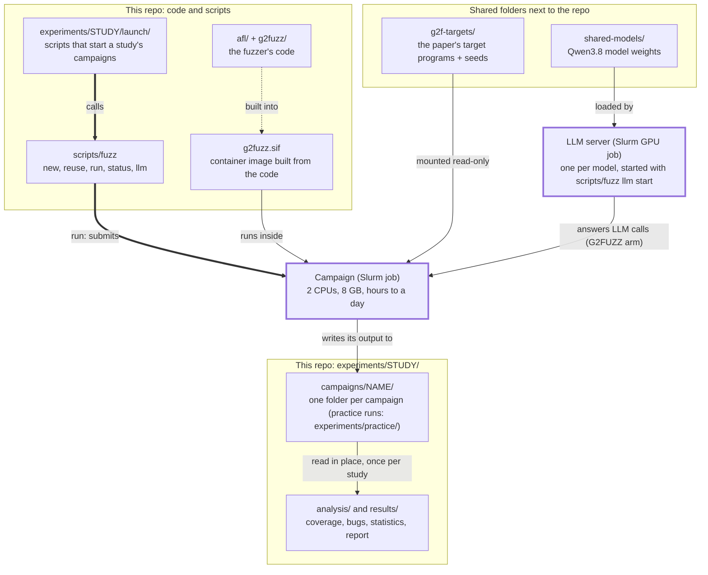
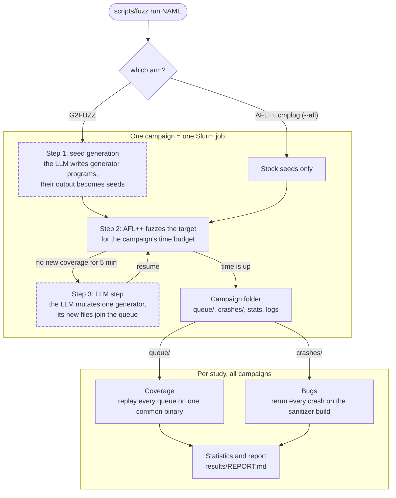
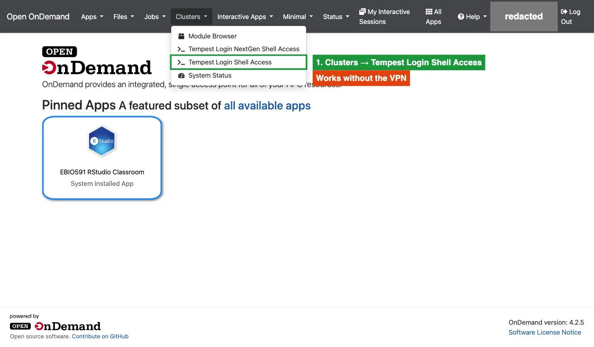
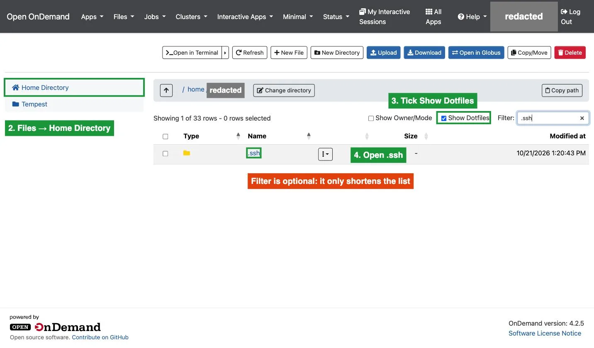
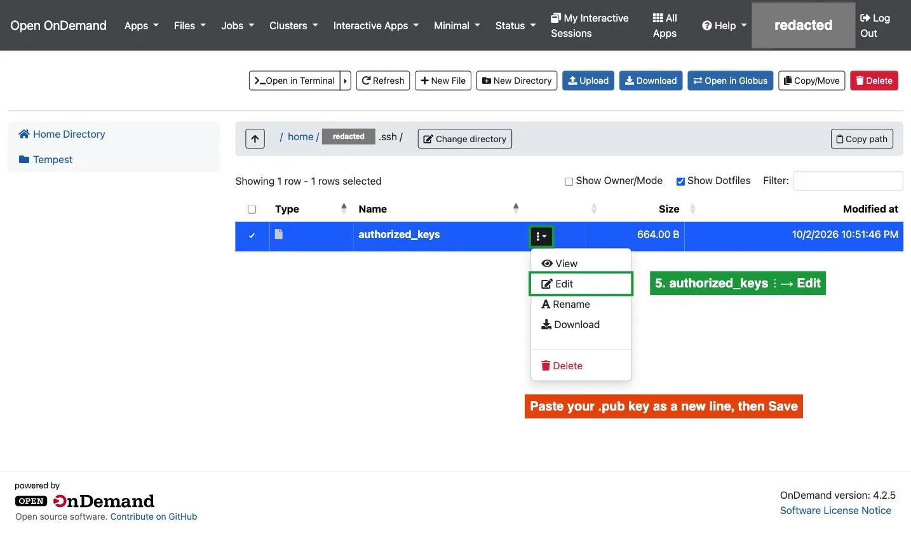
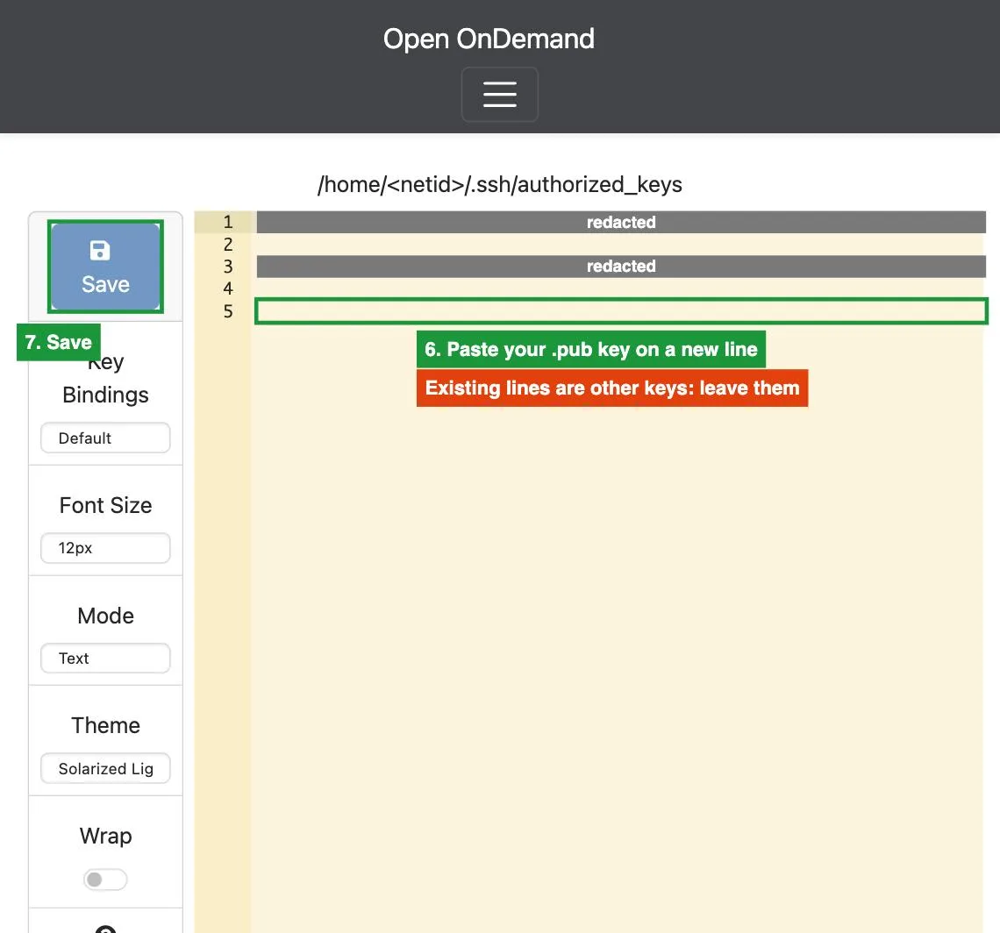
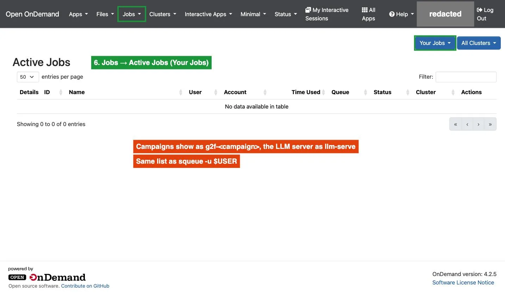

# BETTER-G2FUZZ

Fork of [G2FUZZ](https://github.com/G2FUZZ/G2FUZZ) ([paper](https://arxiv.org/abs/2501.19282)) for a research project at
Montana State University. Goal: replace G2Fuzz's random generator selection with a multi-armed bandit scheduler.

G2FUZZ has an LLM write Python generators for an input format, fuzzes their output with AFL++ 4.32c, and has the
LLM mutate the generators when coverage stalls.

## How it fits together

**Where things live on Tempest.** The repo is one shared checkout; the targets and the model weights are shared folders
next to it; the LLM server and every campaign are Slurm jobs (thick border).



Thick arrows start or submit something. Thin arrows are data used at run time. The dotted arrow is a one-time build
(`scripts/tempest-image`, run from a Mac).

**One campaign, then the study's analysis.** Dashed boxes run only in the G2FUZZ arm; the AFL++ arm starts from the
stock seeds and never calls the LLM. The analysis runs once over all campaigns of a study, not per campaign.



Unlabelled arrows mean "then". `scripts/fuzz reuse` copies another campaign's seeds and skips step 1. Which generator
step 3 mutates is this project's change: our UCB scheduler picks it (the default; `--scheduler random` is upstream's
random pick).

## Quick start (Tempest)
First time only: [Tempest setup](#tempest-setup) steps 1–6. Then:

```bash
ssh tempest
cd /home/group/csci-591-automated-vulnerability-discovery/students/BETTERG2FUZZ
scripts/fuzz llm status                    # the team's model server; none yet? see step 8
scripts/fuzz reuse example $USER-try       # the example run's seeds + generators: skips seed generation
scripts/fuzz run $USER-try 2400 --test     # ~40 min, with 2-3 LLM steps (each takes ~13 min on an A40)
scripts/fuzz watch $USER-try               # Ctrl-C closes it; the run keeps going
```

Campaign folders are shared: put your NetID (`$USER`) in each name.

More: [Step II](#step-ii-run-a-campaign), [docs/EXAMPLE_RUN.md](docs/EXAMPLE_RUN.md) (a real run, start to finish).
Every command with its output: [docs/notes.md](docs/notes.md). Studies (design, launch scripts, results):
[experiments/](experiments/README.md); `scripts/study` launches a study's campaigns from its `launch/study.conf`.

Branches: `dev` is the team's working branch (one shared copy on Tempest). `exploration` keeps the October 2026 experiments as a record. `main` tracks the upstream version.

# How to use it
`scripts/fuzz` runs the upstream steps below for you, on Tempest: each campaign is a Slurm job in the Apptainer image
`g2fuzz.sif`, and the LLM is the team's own model server (Qwen3.8 by default, one server per model). It needs Slurm,
so it doesn't run on a laptop; the Mac is only used to build the image (step 7). Setup: [Tempest setup](#tempest-setup)
steps 1–6, ~15 min. Run `scripts/fuzz` from the repo root, or set up the `fuzz` alias ([Day to day](#day-to-day)) and
run it from any folder.

## Step I: Preparation

### Tempest setup
Tempest can't reach CatChat, so runs use our own model server. Teammates: steps 1–6. Step 7 is the maintainer's;
step 8 is starting an experiment's server (no setup needed). Official docs: [Tempest](https://www.montana.edu/uit/rci/tempest).

**1. Connect the VPN.** SSH needs it, even on MSU-Secure Wi-Fi:
Cisco Secure Client → `vpn.msu.montana.edu` → your student or employee group.
No VPN? The web shell at <https://tempest-web.msu.montana.edu> works without it:



**2. Make an SSH key.** Only the `.pub` file leaves your computer.

```console
$ ssh-keygen -t ed25519 -C "<netid>@tempest" -f ~/.ssh/id_ed25519_tempest
$ pbcopy < ~/.ssh/id_ed25519_tempest.pub        # copies the public key (Linux/WSL: cat it, copy by hand)
```

**3. Add it on Tempest.** Sign in at <https://tempest-web.msu.montana.edu>, then paste it into `~/.ssh/authorized_keys`.
No `.ssh` folder or `authorized_keys`? Create them with **New Directory** / **New File**.







**4. Tell SSH about Tempest.** Add to `~/.ssh/config`:

```
Host tempest
  HostName tempest-login.msu.montana.edu
  User <netid>
  IdentityFile ~/.ssh/id_ed25519_tempest
  IdentitiesOnly yes
  AddKeysToAgent yes
  IgnoreUnknown UseKeychain
  UseKeychain yes
```

**5. Connect and check your accounts.**

```console
$ ssh tempest
Are you sure you want to continue connecting (yes/no/[fingerprint])? yes
[<netid>@tempest-login ~]$ sacctmgr -nP show assoc user=$USER format=account
group-csci-591-automated-vulnerability-discovery
priority-csci-591-automated-vulnerability-discovery
```

Type `yes` only if the fingerprint is `SHA256:7mk+Xk/AepBmtj03PHQaiZJBnNnWWAJDSFtOJy6wy1Q` (ED25519; older clients may
show ECDSA `SHA256:PyOIbM6dL+Wks93FQqXjJoeo28aquaCe8A5kLGqFm8o`). Asked once per computer.

**6. Go to the shared copy.** The team runs everything from one copy on `dev`: one image, one `experiments/` folder.

```console
$ cd /home/group/csci-591-automated-vulnerability-discovery/students/BETTERG2FUZZ
$ git config --global --add safe.directory "$PWD"     # one time: lets git work in a folder another user owns
$ scripts/fuzz account
group-csci-591-automated-vulnerability-discovery
```

Don't switch its branch: that changes the code for everyone. Settings are automatic; override in `~/.bashrc` only if needed:

| Variable | Default on Tempest |
| --- | --- |
| `G2F_ACCOUNT` | `group-csci-591-automated-vulnerability-discovery` (another group's only when you set it; campaigns then use that group's servers) |
| `G2F_PARTITION` | `fairshare` |
| `G2F_CPUS`, `G2F_MEM` | `2`, `8G` per job |
| `G2F_BASE_URL`, `G2F_KEY` | the team's running `llm` server (step 8) |

**7. Get the image (maintainer only).** It's already in the shared copy. Tempest can't build Docker images, so one
person builds it on a Mac. One time:

```bash
brew install docker-buildx
mkdir -p ~/.docker/cli-plugins && ln -sf "$(brew --prefix)/bin/docker-buildx" ~/.docker/cli-plugins/
colima stop && colima start --vz-rosetta        # fast x86_64 builds
```

After each code change, commit and push, then from the Mac repo (VPN on, ~10 min): `scripts/tempest-image`.
It replaces `build/g2fuzz.sif` in the shared copy, writes the git version to `build/g2fuzz.sif.version`, and refuses while
anyone's campaigns run. The image holds the code: `git pull` on Tempest alone changes nothing.

**8. The model server: one per model.** One person starts it; everyone's runs find it. By default it serves
`Qwen3.8-27B-FP8-nothink` with vLLM from the shared `students/shared-models` folder, so there's nothing to download.
Thinking is off: our build gives up on an LLM call after 300 s (`G2F_LLM_TIMEOUT`; upstream G2Fuzz has no limit of its own and uses the OpenAI SDK's 600 s). Qwen won our model bake-off against `gpt-oss:120b` and
`llama3:70b`: the only one to finish seed generation in every run (20–40 min), and the most coverage after it on
mp42aac and pdftotext (about even with gpt-oss on jhead).

| Command | Does |
| --- | --- |
| `scripts/fuzz llm start [hours]` | 1 A40 on the class priority account: starts right away (default 24 h; the class has 2 GPUs) |
| `scripts/fuzz llm start [hours] h100` | 1 H100 on `gpufairshare`: uses no class GPU, but may wait hours or days |
| `G2F_ACCOUNT=priority-quantumcore scripts/fuzz llm start [hours] qc-h100` (or `qc-a40`) | 1 H100 (A40) on `gpupriority` with `priority-quantumcore`: the quantumcore group's account (4 H100), only for members of that account (partners aren't), with that group's OK. Never the default. Campaigns use only servers of their own account's family, so run those campaigns with the same `G2F_ACCOUNT` (and `G2F_PARTITION=priority`) |
| `scripts/fuzz llm status` | The team's server: owner, queued, loading or ready, time left |
| `scripts/fuzz llm host` | The running server's `<node>:<port>` (e.g. for an SSH tunnel) |
| `scripts/fuzz llm stop` | Stops your server. Refuses while anyone's campaigns run |

**Other models: `--model <folder>`**, any folder in `students/shared-models` (`scripts/fetch-models` downloads
more). `new`/`reuse` record the model in the campaign's `model_setting.json`; `run` and `shell` then use that model's
server, so each campaign keeps its model. `llm start|stop|status|host --model <folder>` act on that model's server:
one server per model, so two models can run side by side on the class's two A40s.
`scripts/study start <study> --servers` starts and stops a study's servers itself.

```bash
scripts/fuzz llm start 24 --model phi-4
scripts/fuzz new jhead-phi4 --model phi-4 && scripts/fuzz run jhead-phi4 86400
```

| Folder | Served with | GPU |
| --- | --- | --- |
| `Qwen3.8-27B-FP8` (default) | 32K context, thinking off | A40 |
| `DeepSeek-Coder-V2-Lite-Instruct` | 32K context | A40 |
| `phi-4` | 16K context (its maximum) | A40 |
| `starcoder2-15b-instruct-v0.1` | 16K context; `scripts/chat-templates/starcoder2-instruct.jinja`, since its own template refuses system messages | A40 |
| `Mistral-Small-3.1-24B-Instruct-2503` | 32K context, text only; fp8 on an A40 (the bf16 weights don't fit), bf16 on an H100 | A40 (fp8) or H100 |

`Llama-3.1-8B-Instruct` is not downloaded yet (gated: accept its license on huggingface.co, log in, then
`scripts/fetch-models meta-llama/Llama-3.1-8B-Instruct`; it is served like DeepSeek, 32K context on an A40).

`start` refuses while a server for that model is up. Start it for longer than the experiment's runs (a run that outlasts it loses its
LLM; `run` refuses while it is still loading) and stop it when done. Speed: an A40 has no native FP8, so calls take ~2.5× longer than on an A100/H100
(median ~50 s); a long generator rewrite can pass our 300 s limit, and the call is then retried. `~/llm/VERSIONS.txt` records the model revision and GPU for the write-up.

### The setting files
Upstream asks you to set up three files by hand; `scripts/fuzz new` does it for each campaign, in its folder (default `experiments/practice/campaigns/<campaign>/`):
- `openai_key.txt`: the key, mounted read-only (`~/llm/dummy.key`, made for you: the team's server takes any key).
- `program_to_format.json`: copied from `g2fuzz/program_to_format.json`. `--program` must be one of its keys.
- `model_setting.json`: the model (default `Qwen3.8-27B-FP8-nothink`; `--model <folder>` picks another).

G2Fuzz and the targets are compiled inside the image (`make source-only`, then `/targets/<name>.afl` and `.cmp`), as
upstream describes. `scripts/fuzz help` lists all settings (key, server, model, target, image).

## Step II: Run a campaign
Seed generation (upstream Step II) and fuzzing (upstream Step III) run as one campaign:

```bash
scripts/fuzz llm status               # "ready"? No server: scripts/fuzz llm start 2
scripts/fuzz new $USER-first
scripts/fuzz run $USER-first 900 --test
scripts/fuzz watch $USER-first
```

- Seed generation runs first (20 min to 2 h, depending on the target), then fuzzing for 900 s.
- `--test` fires the LLM step (`llmGen-M`) after 10 s without new coverage, so you see one. Never use it for experiments.
- Ctrl-C closes `watch`; the run keeps going. When it finishes: `scripts/fuzz results $USER-first`.
- The job shows up as `g2f-<netid>-first` (the server as `llm-serve`). A job that ends at once: read
  `slurm-<jobid>.out` in the campaign folder (it checks the LLM first).



### Commands

| Command | Does |
| --- | --- |
| `new [name]` | Create a campaign in `experiments/practice/campaigns/` (default name `<netid>-<target>-MMDD-HHMM`) |
| `reuse <from> [name]` | New campaign with `<from>`'s seeds and generators. Skips seed generation (20 min to 2 h) |
| `run <name> [secs] [--test]` | Background run: seed generation if needed, then fuzz (default 3600 s), as a Slurm job |
| `run <name> [secs] --afl` | The paper's baseline, AFL++(cmplog): same fuzzer, no LLM, stock seeds. Needs no server |
| `run <name> [secs] --scheduler random` | Upstream's random generator pick instead of our UCB scheduler (the default), e.g. for comparisons. `status` shows which one a campaign uses |
| `shell <name>` | Shell in the image, in that campaign (an interactive Slurm job, up to 4 h) |
| `watch <name>` | Live view (Ctrl-C closes it; the run keeps going) |
| `status [name]`, `results <name>`, `list` | Numbers once, final summary, all campaigns |
| `stop <name>` | Stop the run (`scancel`, after copying the output back). Files stay |
| `completion` | Tab completion + the `fuzz` alias for bash; set it up once with `source scripts/enable-completion` |

Run `watch`, `status` and `list` on the login node. What you see (a 40-minute `--test` run with the UCB scheduler):

```console
$ scripts/fuzz status zach-ubc
zach-ubc  [ended]

phase        finished
run time     0:40:00
corpus       1152
crashes      12
coverage     582 edges (29.66%)
speed        0.00 execs/s, 1759904 total
last find    9s ago   (LLM step after 10s without one)
llmGen-M     3 steps
scheduler    ucb (exploration 1.0)
LLM calls    12 (12 ok)   last: ok after 137.15s, 1544s ago

$ scripts/fuzz results zach-ubc
...
generators        : 34
scheduler         : ucb (exploration 1.0)
llmGen-M steps    : 3
LLM calls         : 12 (12 ok, 0 errors)
generator lineage : {"jpg-15.py": ["jpg-33.py"], "xmp-10.py": ["xmp-34.py"]}
crashes dir       : experiments/practice/campaigns/zach-ubc/jhead_output/default/crashes
```

`generator lineage` shows which generator each LLM step mutated into which (`speed` reads 0 once a run has ended).

### Output files
Everything is in the campaign folder (default `experiments/practice/campaigns/<campaign>/`) and stays after the run. AFL++ writes `jhead_output/` on fast local disk (it is
5–8x slower on a network home or shared folder); the copy in the campaign folder is updated every 30 s and when the run ends or
is stopped. Pip installs from generators go to `<campaign>/.pyuser/`.

| Path | Contents |
| --- | --- |
| `seedgen.log`, `fuzz.log` | Logs from seed generation and fuzzing |
| `llm_calls.jsonl` | One line per LLM request: latency, success or error, retry attempt |
| `jhead_output/default/queue/` | Corpus. `orig:jpg-N_k` entries came from G2Fuzz generators |
| `jhead_output/default/crashes/` | Crashing inputs |
| `jhead_output/default/generators/` | Python generators the LLM wrote |
| `jhead_output/default/fuzzer_stats`, `plot_data` | Coverage and speed (`afl-plot` graphs these) |
| `jhead_output/default/mutation_log/relationship.json` | Which generator was mutated into which |
| `jhead_output/default/mutation_log/generator_scheduler_state.json` | UCB's bookkeeping: each generator's credit, children, failures |
| `generator_scheduler`, `ucb_exploration` | Which scheduler the run used (`status` shows it) |
| `jhead_output/default/gen_seeds_energy_log` | Seeds added and time spent in the LLM |
| `job.sbatch`, `run.sh`, `slurm-<jobid>.out` | The Slurm job |

Debugging the pipeline? The raw commands `scripts/fuzz` runs: [docs/BY_HAND.md](docs/BY_HAND.md).

## Day to day

**`fuzz` alias + Tab completion (Tempest, bash):** run once. Then `fuzz` means `scripts/fuzz` from any folder (it wins
over any other `fuzz` on your PATH, e.g. an old `~/bin/fuzz`), and Tab completes commands, campaign names, options
and model folders: `fuzz run <Tab>` lists your campaigns, `fuzz run <name> 900 --<Tab>` the options.

```bash
source scripts/enable-completion      # adds one line to ~/.bashrc (only once) and turns it on in this shell
```

**Change the code,** then rebuild the image (`scripts/tempest-image` from the Mac, step 7) and start a new campaign:

| What | File |
| --- | --- |
| The generator scheduler (UCB) | `g2fuzz/py_utils/generator_scheduler.py` |
| Where the scheduler is called (generator and mutator selection) | `g2fuzz/generator_mutation.py` |
| Seed generation | `g2fuzz/program_gen.py` |
| LLM calls, retries, logging | `g2fuzz/py_utils/llm_utils.py` |
| When `llmGen-M` triggers | `afl/src/afl-fuzz.c` (search `G2F:`) |
| Image contents | `build/Dockerfile.g2fuzz` |

**Change `scripts/fuzz`** (no image rebuild needed): run `scripts/tests/test_fuzz_cli.sh` on Tempest before committing.
It compares every command with the committed version under fake Slurm, and checks what other scripts read from its
output. An intended change shows up as a difference: check it, then commit.

**The paper's targets** (Tempest): `paper/` has the paper's exact versions (all 25 UNIFUZZ, FuzzBench and MAGMA
projects), `latest/` the newest releases. Each target's arguments and seeds come from the folder; `ls` it (`*.afl`) for
the names. `g2f-targets/afl503/` holds AFL++ 5.03c builds (for the archived G2FUZZ-upgradedAFL copy). Build scripts: `build/targets/`
(`build-paper.sh`, tested by `build/targets/test_paper_targets.sh`). Keep both set for `new` and `run`:

```bash
export G2F_TARGETS=/home/group/csci-591-automated-vulnerability-discovery/students/g2f-targets/paper
export G2F_TARGET=libpng_libpng_read_fuzzer
scripts/fuzz new $USER-png1 && scripts/fuzz run $USER-png1 3600
```

**Results on the Mac:**

```bash
rsync -a tempest:/home/group/csci-591-automated-vulnerability-discovery/students/BETTERG2FUZZ/experiments/practice/campaigns/<campaign> experiments/practice/campaigns/
```

Then read its files there (`fuzzer_stats`, `plot_data`, `crashes/`); `scripts/fuzz` itself only runs on Tempest.

**Tempest's model from the Mac** (VPN on), through a tunnel:

```bash
ssh -f -N -L 8000:$(ssh tempest /home/group/csci-591-automated-vulnerability-discovery/students/BETTERG2FUZZ/scripts/fuzz llm host) tempest
curl -s http://localhost:8000/v1/models     # the server answers on your Mac now, e.g. to try prompts
pkill -f "ssh -f -N -L 8000"      # close it afterwards
```

**Teammates can't open your files?** AFL++ writes its output readable only by you. `scripts/group-perms` gives
the group access to everything you own in the shared folder ([docs/GROUP_PERMISSIONS.md](docs/GROUP_PERMISSIONS.md));
`scripts/fuzz` already does it for each run's output.

**Git:**
- Work on `dev`. The shared copy on Tempest stays on `dev` (everyone runs from it).
- Campaign folders (`experiments/*/campaigns/`) and keys are git-ignored. Don't force-add them.

**Push to GitHub from Tempest (optional):** [docs/GITHUB_FROM_TEMPEST.md](docs/GITHUB_FROM_TEMPEST.md).

# Contact

From the upstream README (the G2FUZZ authors). If you have any questions or suggestions, feel free to contact me via email: [kzhangcl@connect.ust.hk](mailto:kzhangcl@connect.ust.hk)
