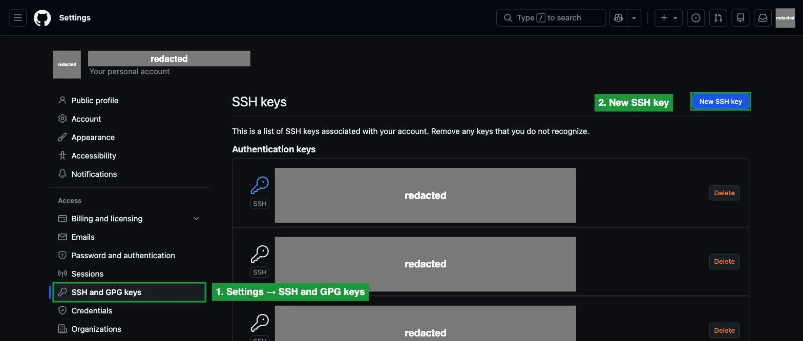
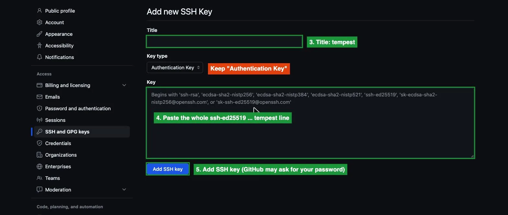

# Push to GitHub from Tempest (optional)

Tempest needs its own key; you need write access to the repo.

```console
[<netid>@tempest-login ~]$ ssh-keygen -t ed25519 -N "" -C "tempest" -f ~/.ssh/github_tempest
[<netid>@tempest-login ~]$ cat ~/.ssh/github_tempest.pub
ssh-ed25519 AAAAC3NzaC1lZDI1NTE5AAAAILx7...  tempest
```

Add that line on github.com → **Settings** → **SSH and GPG keys** → **New SSH key** (repo owner only, alternative:
the repo's **Settings → Deploy keys** with **Allow write access**).





```console
[<netid>@tempest-login ~]$ printf '\nHost github.com\n  IdentityFile ~/.ssh/github_tempest\n  IdentitiesOnly yes\n' >> ~/.ssh/config
[<netid>@tempest-login ~]$ ssh -T git@github.com
Hi <github-user>! You've successfully authenticated, but GitHub does not provide shell access.
[<netid>@tempest-login ~]$ git push --dry-run origin dev        # checks access, sends nothing
```

Type `yes` to the first `ssh -T` only for GitHub's fingerprint `SHA256:+DiY3wvvV6TuJJhbpZisF/zLDA0zPMSvHdkr4UvCOqU`.

| You see | Fix |
| --- | --- |
| `git@github.com: Permission denied (publickey).` | Key not added on GitHub, or the `~/.ssh/config` lines are missing |
| `Permission to zachariahcraven/BETTER-G2FUZZ.git denied` | Your account has no write access: ask the owner |
| `git push` asks for a username | The remote is `https://`: `git remote set-url origin git@github.com:zachariahcraven/BETTER-G2FUZZ.git` |
